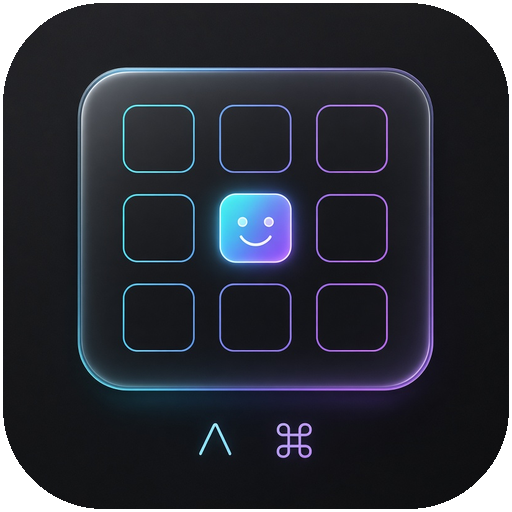

<p align="center"></p>

```
███████╗███╗   ███╗ ██████╗      ██╗██╗
██╔════╝████╗ ████║██╔═══██╗     ██║██║
█████╗  ██╔████╔██║██║   ██║     ██║██║
██╔══╝  ██║╚██╔╝██║██║   ██║██   ██║██║
███████╗██║ ╚═╝ ██║╚██████╔╝╚█████╔╝██║
╚══════╝╚═╝     ╚═╝ ╚═════╝  ╚════╝ ╚═╝
██████╗ ██╗ ██████╗██╗  ██╗███████╗██████╗ 
██╔══██╗██║██╔════╝██║ ██╔╝██╔════╝██╔══██╗
██████╔╝██║██║     █████╔╝ █████╗  ██████╔╝
██╔═══╝ ██║██║     ██╔═██╗ ██╔══╝  ██╔══██╗
██║     ██║╚██████╗██║  ██╗███████╗██║  ██║
╚═╝     ╚═╝ ╚═════╝╚═╝  ╚═╝╚══════╝╚═╝  ╚═╝
            ⌃ ⌘ ␣  ·  for Alfred  ·  type e and go
```

Type `e` or `emoji` in [Alfred](https://www.alfredapp.com) to open the built-in macOS emoji picker (the same one as `Ctrl+Cmd+Space`) in the app you were just using.

The built-in picker has the full, current Unicode emoji set, so there's no emoji list to keep up to date.

## Install

Download `Mac-Emoji-Picker.alfredworkflow` from [Releases](../../releases) (or run `./build.sh`) and double-click it.

Alfred needs Accessibility permission to send the keystroke: System Settings > Privacy & Security > Accessibility > Alfred.

## How it works

Two keyword inputs (`e`, `emoji`) run a short script that waits 0.3 seconds for focus to return to your previous app, then presses `Ctrl+Cmd+Space`:

```sh
sleep 0.3
osascript -e 'tell application "System Events" to key code 49 using {control down, command down}'
```

If the picker opens before your app has focus, raise the `sleep` value in `workflow/info.plist`.

## Build

```sh
./build.sh   # writes Mac-Emoji-Picker.alfredworkflow
```
